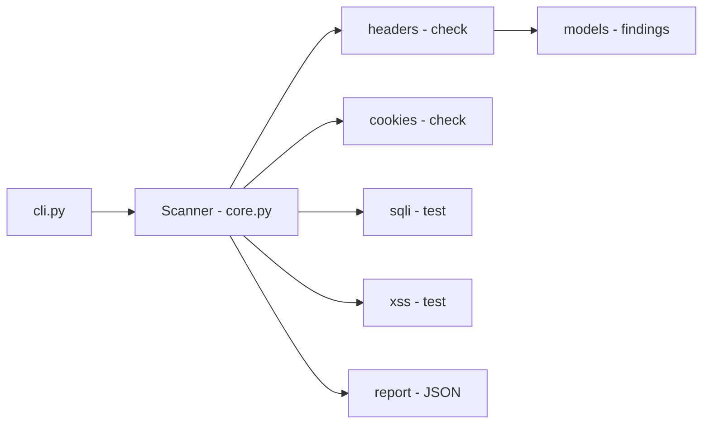

# scanner-owasp-top10-web

**English** · [Português (Brasil)](README.md)

[](#) [](#) [](#) [](#) [](LICENSE)

## What it is

A **web security scanner** that checks HTTP targets against a set of checks inspired by the **OWASP Top 10**: security headers, cookies, SQL injection and XSS. It runs from the command line and produces a report (JSON by default). It is an educational auditing tool.

## ⚠️ Ethical and legal use warning

This is an **auditing** tool. Use it only on systems **you own** or with **explicit written authorization**. Scanning third-party systems without permission is illegal and unethical.

## Status

A working security lab, with 70 tests.

> **Warning (verified by the agent):** the repository contains **committed duplicated structure** (`src/src/…` and `tests/tests/…`). The **70 tests pass** with `PYTHONPATH=src pytest tests/`. See `HYGIENE.md`.

## Features

- **Security header check** (`headers.py`): detects missing baseline headers.
- **Cookie check** (`cookies.py`): evaluates security attributes (HttpOnly, Secure, etc.).
- **SQL injection test** (`sqli.py`) and **XSS test** (`xss.py`) on parameters.
- **Scanning engine** (`core.py`, class `Scanner`): orchestrates the checks against a target URL.
- **Report** (`report.py`): JSON output by default.
- **CLI**: target (URL), report format, output file and timeout.

## Architecture

A `scanner_owasp` package with `core` (engine), check modules (`headers`, `cookies`, `sqli`, `xss`), `models` (findings), `report` (output) and `cli`. `Scanner.scan(target)` runs all checks and aggregates the findings.



## Stack

- Python ≥ 3.10
- requests ≥ 2.31, beautifulsoup4 ≥ 4.12
- pytest (dev)

## Repository layout

```
scanner-owasp-top10-web/
├── pyproject.toml · BRIEF.md
├── src/scanner_owasp/
│   ├── core.py       # scan engine
│   ├── headers.py · cookies.py · sqli.py · xss.py
│   ├── models.py · report.py · cli.py
│   └── __main__.py
├── tests/            # 7 files, 70 tests
├── LICENSE           # MIT
└── (committed duplicates: src/src/…, tests/tests/…)  # see HYGIENE
```

## Prerequisites and installation

Python ≥ 3.10.

```bash
pip install -e .
```

## How to run

```bash
python -m scanner_owasp https://example.com/page?id=1
# or as a script
scanner-owasp <target> [--formato json|...] [--saida file] [--timeout 10.0]
```

## Tests and quality

Real run (verified by the agent):

```bash
PYTHONPATH=src python -m pytest tests/
# 70 passed
```

> `pytest tests/` without `PYTHONPATH` fails at collection because of the committed duplicated structure (see Status).

## Technical decisions and trade-offs

- **Deterministic HTTP checks** (via `requests`) instead of a browser: fast and light; in exchange, JavaScript is not executed.
- **JSON report**: easy to integrate into pipelines.
- **OWASP Top 10 web focus** (headers, cookies, SQLi, XSS): common initial-audit coverage.

## Known limitations and roadmap

- Does not execute JavaScript or test complex SPAs.
- SQLi/XSS uses simple payloads; may produce false negatives behind a WAF.
- The checks cover a subset of the OWASP Top 10; it does not replace a full scanner or manual analysis.

## Development process

An individual project by Kelvin Oliveira, built with orchestrated AI agents and reviewed by the author. The scanner architecture and the review are the author's.

## License and author

MIT — Copyright (c) 2026 Kelvin Rebelo de Oliveira.

**Author**: [Kelvin Oliveira](https://github.com/KelvinOliveiraCode) · [Portfolio](https://kelvinoliveiracode.github.io/portfolio/)
