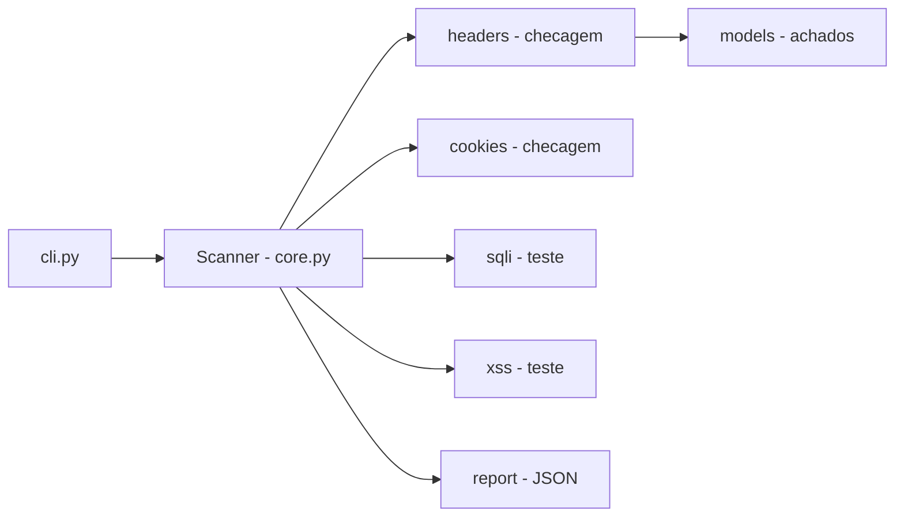

# scanner-owasp-top10-web

[English](README.en.md) · **Português (Brasil)**

[](#) [](#) [](#) [](#) [](LICENSE)

## O que é

**Scanner de segurança web** que verifica alvos HTTP contra um conjunto de checagens inspiradas no **OWASP Top 10**: cabeçalhos de segurança, cookies, SQL injection e XSS. Executa por linha de comando e gera relatório (JSON por padrão). É uma ferramenta de auditoria educacional.

## ⚠️ Aviso de uso ético e legal

Esta é uma ferramenta de **auditoria**. Use apenas em sistemas **que você possui** ou com **autorização explícita por escrito**. Escanear sistemas de terceiros sem permissão é ilegal e antiético.

## Status

Laboratório funcional de segurança, com 70 testes.

> **Aviso (verificado pelo agente):** o repositório contém **estrutura duplicada commitada** (`src/src/…` e `tests/tests/…`). Os **70 testes passam** com `PYTHONPATH=src pytest tests/`. Ver `HYGIENE.md`.

## Funcionalidades

- **Verificação de cabeçalhos de segurança** (`headers.py`): detecta ausência dos headers básicos.
- **Verificação de cookies** (`cookies.py`): avalia atributos de segurança (HttpOnly, Secure, etc.).
- **Teste de SQL injection** (`sqli.py`) e **XSS** (`xss.py`) em parâmetros.
- **Motor de varredura** (`core.py`, classe `Scanner`): orquestra as checagens sobre uma URL alvo.
- **Relatório** (`report.py`): saída em JSON por padrão.
- **CLI**: alvo (URL), formato do relatório, arquivo de saída e timeout.

## Arquitetura

Pacote `scanner_owasp` com 'core' (motor), módulos de checagem (`headers`, `cookies`, `sqli`, `xss`), `models` (achados), `report` (saída) e `cli`. O `Scanner.scan(target)` roda todas as checagens e agrega os achados.



## Stack

- Python ≥ 3.10
- requests ≥ 2.31, beautifulsoup4 ≥ 4.12
- pytest (dev)

## Estrutura do repositório

```
scanner-owasp-top10-web/
├── pyproject.toml · BRIEF.md
├── src/scanner_owasp/
│   ├── core.py       # motor do scanner
│   ├── headers.py · cookies.py · sqli.py · xss.py
│   ├── models.py · report.py · cli.py
│   └── __main__.py
├── tests/            # 7 arquivos, 70 testes
├── LICENSE           # MIT
└── (duplicados commitados: src/src/…, tests/tests/…)  # ver HYGIENE
```

## Pré-requisitos e instalação

Python ≥ 3.10.

```bash
pip install -e .
```

## Como executar

```bash
python -m scanner_owasp https://example.com/page?id=1
# ou, via script
scanner-owasp <target> [--formato json|...] [--saida arquivo] [--timeout 10.0]
```

## Testes e qualidade

Execução real (verificada pelo agente):

```bash
PYTHONPATH=src python -m pytest tests/
# 70 passed
```

> `pytest tests/` sem `PYTHONPATH` falha na coleta por causa da estrutura duplicada commitada (ver Status).

## Decisões técnicas e trade-offs

- **Checagens determinísticas por HTTP** (via `requests`) em vez de navegador: rápido e leve; em troca, não executa JavaScript.
- **Relatório JSON**: fácil de integrar a pipelines.
- **Escopo focado no OWASP Top 10** web (headers, cookies, SQLi, XSS): cobertura comum de auditoria inicial.

## Limitações conhecidas e roadmap

- Não executa JavaScript nem testa SPA complexas.
- O SQLi/XSS usa payloads simples; pode gerar falsos negativos em aplicações com WAF.
- As checagens cobrem um subconjunto do OWASP Top 10; não substitui um scanner completo nem análise manual.

## Processo de desenvolvimento

Projeto individual de Kelvin Oliveira, construído com agentes de IA orquestrados e revisado pelo autor. A arquitetura do scanner e a revisão são do autor.

## Licença e autor

MIT — Copyright (c) 2026 Kelvin Rebelo de Oliveira.

**Autor**: [Kelvin Oliveira](https://github.com/KelvinOliveiraCode) · [Portfólio](https://kelvinoliveiracode.github.io/portfolio/)
